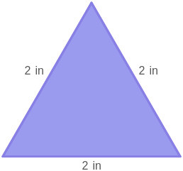

# AVP1572 — Single visual target

MathVerse:510 / MathVista:399 · different type · Mathematical roles of graphical elements

## Shared or similar visual information

A shaded region.

## Evidence locations

- Left image: The gray half-plane on the right side of the solid oblique boundary.
- Right image: The lavender triangle with three 2 in side labels.

## Mathematical meanings

Left image: The shaded points constitute the solution region on one side of the linear boundary. Right image: The shading designates the entire area inside the equilateral triangle.

## Same mathematical meanings

no

## Rationales

The feature selects the solution half-plane of a linear inequality in the left image and selects a geometric area in the right image. The gray half-plane on the right side of the solid oblique boundary. The lavender triangle with three 2 in side labels.

Only the selected target is annotated. AI visual-review draft; not independently double-annotated by humans.
