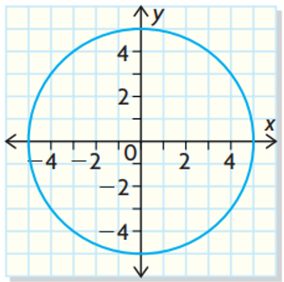

# AVP1576 — Single visual target

MathVerse:484 / MathVista:409 · different type · Mathematical roles of graphical elements

## Shared or similar visual information

An unfilled circular outline.

## Evidence locations

- Left image: The hollow circle at the right end of the curve at (3, 2).
- Right image: The cyan circle centered where the two axes meet.

## Mathematical meanings

Left image: The open endpoint excludes (3, 2) from the function graph. Right image: The outline is the circumference of the circle plotted around the origin.

## Same mathematical meanings

no

## Rationales

The feature marks an ordered pair excluded from the plotted trace in the left image and traces the circumference of a geometric circle in the right image. The hollow circle at the right end of the curve at (3, 2). The cyan circle centered where the two axes meet.

Only the selected target is annotated. AI visual-review draft; not independently double-annotated by humans.
