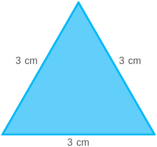
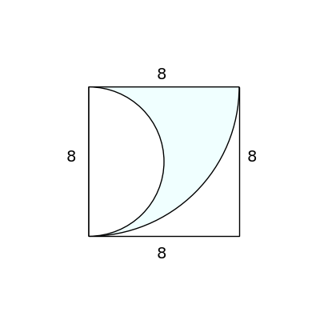

# AVP1580 — Single visual target

MathVista:441 / DynaMath:112 · same type · Mathematical roles of graphical elements

## Shared or similar visual information

A shaded region.

## Evidence locations

- Left image: The cyan triangle with three 3 cm side labels.
- Right image: The pale blue patch between the semicircle and the arc inside the square.

## Mathematical meanings

Left image: The shading designates the entire area inside the equilateral triangle. Right image: The shading selects the area inside the arc and outside the semicircle within the square.

## Same mathematical meanings

yes

## Rationales

In both images the feature selects a geometric area. The cyan triangle with three 3 cm side labels. The pale blue patch between the semicircle and the arc inside the square.

Only the selected target is annotated. AI visual-review draft; not independently double-annotated by humans.
