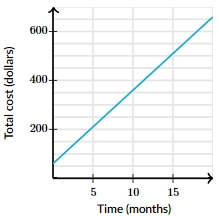
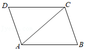

# AVP1581 — Single visual target

MathVerse:594 / MathVista:32 · different type · Mathematical roles of graphical elements

## Shared or similar visual information

A solid straight line rising from left to right.

## Evidence locations

- Left image: The rising cyan line on the total-cost versus time plot.
- Right image: The rising straight segment from A to C inside ABCD.

## Mathematical meanings

Left image: The line shows that total cost rises at a constant rate with time. Right image: The segment is a diagonal connecting opposite vertices of the quadrilateral.

## Same mathematical meanings

no

## Rationales

The feature plots a linear relationship between coordinates in the left image and connects opposite vertices of a quadrilateral in the right image. The rising cyan line on the total-cost versus time plot. The rising straight segment from A to C inside ABCD.

Only the selected target is annotated. AI visual-review draft; not independently double-annotated by humans.
