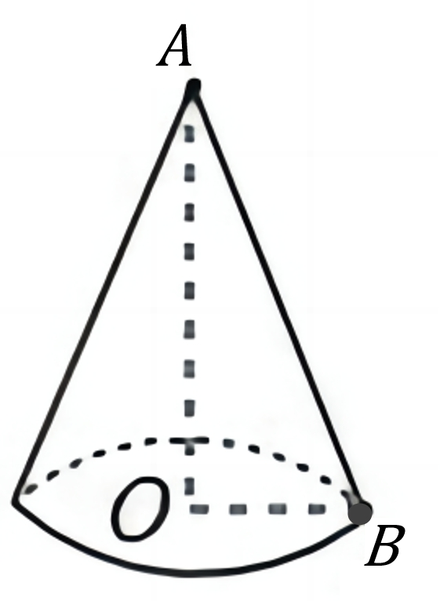

# AVP1582 — Single visual target

DynaMath:8 / VisioMath:616_A · same type · Mathematical roles of graphical elements

[Right image in official archive](https://raw.githubusercontent.com/Nefefilibata/VisioMath/4a912153e110001da261917902e1d3cc163b7c6a/data/images.zip) · `images/616_A.jpg`

## Shared or similar visual information

A dashed curve.

## Evidence locations

- Left image: The dashed arc along the rear half of the cone base near O.
- Right image: The dashed rear part of the lower ellipse of the upright cylinder.

## Mathematical meanings

Left image: The dashed arc draws the occluded part of the cone’s circular base rim. Right image: The dashed arc draws the occluded part of the cylinder’s lower circular rim.

## Same mathematical meanings

yes

## Rationales

In both images the feature shows the occluded part of the circular rim of a solid. The dashed arc along the rear half of the cone base near O. The dashed rear part of the lower ellipse of the upright cylinder.

Only the selected target is annotated. AI visual-review draft; not independently double-annotated by humans.
