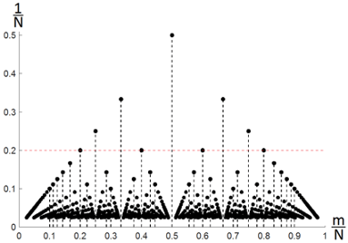

# AVP1583 — Single visual target

VisioMath:505_A / MathVista:738 · different type · Mathematical roles of graphical elements

[Left image in official archive](https://raw.githubusercontent.com/Nefefilibata/VisioMath/4a912153e110001da261917902e1d3cc163b7c6a/data/images.zip) · `images/505_A.jpg`

## Shared or similar visual information

A horizontal dashed line.

## Evidence locations

- Left image: The horizontal dashed line at the bottom back of the rectangular box.
- Right image: The red dotted horizontal line through the 0.2 tick.

## Mathematical meanings

Left image: The dashed horizontal line depicts the hidden back edge of the box base. Right image: The dotted line supplies a comparison level of 0.2 for the plotted points.

## Same mathematical meanings

no

## Rationales

The feature shows an occluded horizontal edge of a solid in the left image and marks a fixed output level for comparison in the right image. The horizontal dashed line at the bottom back of the rectangular box. The red dotted horizontal line through the 0.2 tick.

Only the selected target is annotated. AI visual-review draft; not independently double-annotated by humans.
