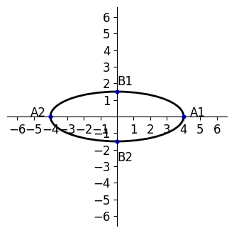

# AVP1585 — Single visual target

DynaMath:177 / VisioMath:1414_A · different type · Mathematical roles of graphical elements

[Right image in official archive](https://raw.githubusercontent.com/Nefefilibata/VisioMath/4a912153e110001da261917902e1d3cc163b7c6a/data/images.zip) · `images/1414_A.jpg`

## Shared or similar visual information

An oval drawn with an unbroken outline.

## Evidence locations

- Left image: The plane oval through A1 at x = 4 and A2 at x = −4.
- Right image: The solid upper oval of the truncated cone.

## Mathematical meanings

Left image: The oval is the ellipse marked with semiaxes along the coordinate axes. Right image: The oval represents the smaller circular rim of the frustum in perspective.

## Same mathematical meanings

no

## Rationales

The feature traces a plane ellipse on the axes in the left image and shows a circular rim of a solid in perspective in the right image. The plane oval through A1 at x = 4 and A2 at x = −4. The solid upper oval of the truncated cone.

Only the selected target is annotated. AI visual-review draft; not independently double-annotated by humans.
