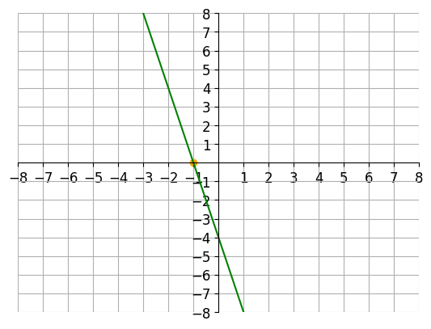

# AVP1589 — Single visual target

DynaMath:109 / MathVerse:482 · same type · Mathematical roles of graphical elements

## Shared or similar visual information

A filled circular point marker.

## Evidence locations

- Left image: The filled yellow-orange dot on the line near its x-intercept.
- Right image: The filled cyan point at (8, 6), at the right end of the trace.

## Mathematical meanings

Left image: The dot identifies an interior point of the straight function graph at its x-intercept. Right image: The filled dot includes the coordinate (8, 6) at the end of the graph.

## Same mathematical meanings

no

## Rationales

The feature identifies a specific point on the interior of the continuing graph in the left image and marks an endpoint included in the plotted branch in the right image. The filled yellow-orange dot on the line near its x-intercept. The filled cyan point at (8, 6), at the right end of the trace.

Only the selected target is annotated. AI visual-review draft; not independently double-annotated by humans.
