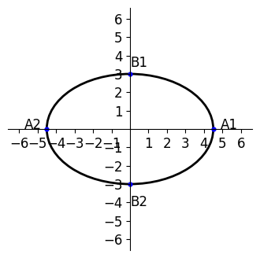

# AVP1591 — Single visual target

DynaMath:175 / VisioMath:322_A · different type · Mathematical roles of graphical elements

[Right image in official archive](https://raw.githubusercontent.com/Nefefilibata/VisioMath/4a912153e110001da261917902e1d3cc163b7c6a/data/images.zip) · `images/322_A.jpg`

## Shared or similar visual information

An oval drawn with an unbroken outline.

## Evidence locations

- Left image: The closed curve through A1, A2, B1 and B2.
- Right image: The continuous oval at the top of the short cylinder above the dashed contour.

## Mathematical meanings

Left image: The oval is the plotted ellipse with horizontal semiaxis 5 and vertical semiaxis 3. Right image: The oval depicts the upper circular rim in the drawing of the cylinder.

## Same mathematical meanings

no

## Rationales

The feature traces a plane ellipse on the axes in the left image and shows a circular rim of a solid in perspective in the right image. The closed curve through A1, A2, B1 and B2. The continuous oval at the top of the short cylinder above the dashed contour.

Only the selected target is annotated. AI visual-review draft; not independently double-annotated by humans.
