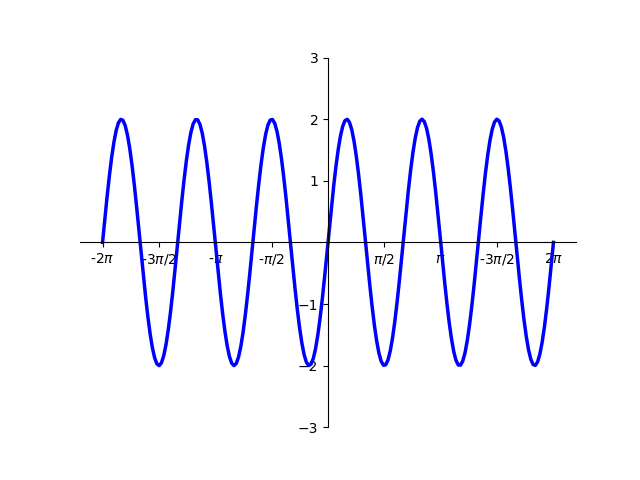

# AVP1594 — Single visual target

MathVerse:556 / DynaMath:1 · different type · Mathematical roles of graphical elements

## Shared or similar visual information

The horizontal coordinate axis.

## Evidence locations

- Left image: The x-axis crossing the middle of the unit circle.
- Right image: The horizontal coordinate line crossed repeatedly by the blue wave.

## Mathematical meanings

Left image: The axis measures the first coordinate of points, including the annotated circle point. Right image: The horizontal axis supplies the input coordinate of the periodic function.

## Same mathematical meanings

yes

## Rationales

In both images the feature measures the horizontal Cartesian coordinate. The x-axis crossing the middle of the unit circle. The horizontal coordinate line crossed repeatedly by the blue wave.

Only the selected target is annotated. AI visual-review draft; not independently double-annotated by humans.
