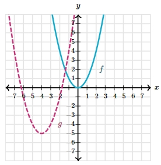

# AVP1595 — Single visual target

MathVerse:568 / VisioMath:1226_A · different type · Mathematical roles of graphical elements

[Right image in official archive](https://raw.githubusercontent.com/Nefefilibata/VisioMath/4a912153e110001da261917902e1d3cc163b7c6a/data/images.zip) · `images/1226_A.jpg`

## Shared or similar visual information

A dashed curve.

## Evidence locations

- Left image: The dashed magenta parabola labeled g, with a vertex left of the y-axis.
- Right image: The elliptical rear arc of the hemisphere’s base drawn with dashes.

## Mathematical meanings

Left image: The dashed trace is the graph of g. Right image: The dashed arc denotes the hidden part of the circular base rim of the hemisphere.

## Same mathematical meanings

no

## Rationales

The feature plots the values of a function in the left image and shows the occluded part of the circular rim of a solid in the right image. The dashed magenta parabola labeled g, with a vertex left of the y-axis. The elliptical rear arc of the hemisphere’s base drawn with dashes.

Only the selected target is annotated. AI visual-review draft; not independently double-annotated by humans.
