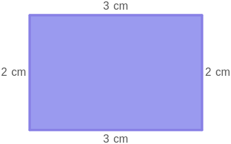

# AVP1596 — Single visual target

VisioMath:1275_A / MathVista:606 · same type · Mathematical roles of graphical elements

[Left image in official archive](https://raw.githubusercontent.com/Nefefilibata/VisioMath/4a912153e110001da261917902e1d3cc163b7c6a/data/images.zip) · `images/1275_A.jpg`

## Shared or similar visual information

A shaded region.

## Evidence locations

- Left image: The black triangle sharing the left vertical side of rectangle ABCD.
- Right image: The lavender rectangle with dimensions 3 cm and 2 cm.

## Mathematical meanings

Left image: The shading designates the area of the triangle attached to AB. Right image: The shading designates the interior area of the rectangle.

## Same mathematical meanings

yes

## Rationales

In both images the feature selects a geometric area. The black triangle sharing the left vertical side of rectangle ABCD. The lavender rectangle with dimensions 3 cm and 2 cm.

Only the selected target is annotated. AI visual-review draft; not independently double-annotated by humans.
