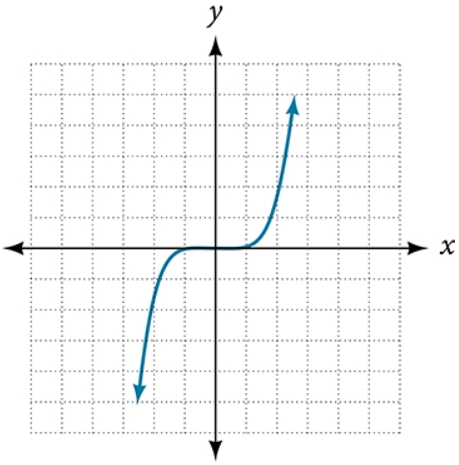
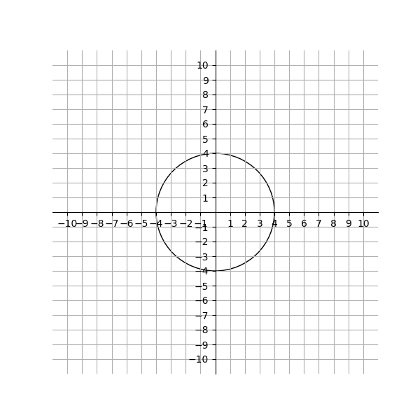

# AVP1598 — Single visual target

MathVerse:477 / DynaMath:213 · different type · Mathematical roles of graphical elements

## Shared or similar visual information

The horizontal coordinate axis.

## Evidence locations

- Left image: The x-axis through the flat section of the blue cubic-shaped curve.
- Right image: The numbered horizontal line through the middle of the grid.

## Mathematical meanings

Left image: The axis measures horizontal Cartesian position for the function. Right image: The axis gives the horizontal coordinate in the plane containing the circle.

## Same mathematical meanings

yes

## Rationales

In both images the feature measures the horizontal Cartesian coordinate. The x-axis through the flat section of the blue cubic-shaped curve. The numbered horizontal line through the middle of the grid.

Only the selected target is annotated. AI visual-review draft; not independently double-annotated by humans.
