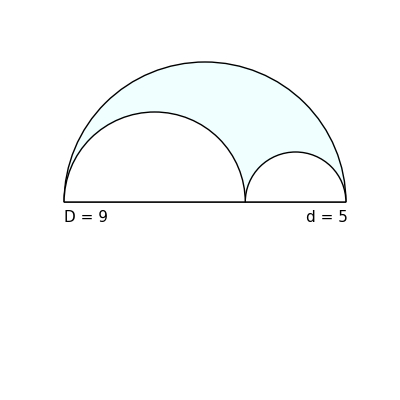
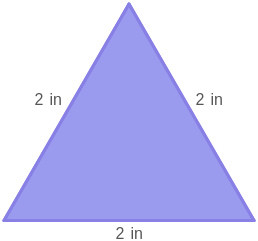

# AVP1600 — Single visual target

DynaMath:122 / MathVista:399 · same type · Mathematical roles of graphical elements

## Shared or similar visual information

A shaded region.

## Evidence locations

- Left image: The pale blue patch inside the large semicircle and above the two smaller ones.
- Right image: The lavender triangle with three 2 in side labels.

## Mathematical meanings

Left image: The shading selects the area bounded by the three semicircular arcs. Right image: The shading designates the entire area inside the equilateral triangle.

## Same mathematical meanings

yes

## Rationales

In both images the feature selects a geometric area. The pale blue patch inside the large semicircle and above the two smaller ones. The lavender triangle with three 2 in side labels.

Only the selected target is annotated. AI visual-review draft; not independently double-annotated by humans.
