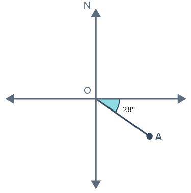

# AVP1601 — Single visual target

MathVerse:334 / VisioMath:311_A · same type · Mathematical roles of graphical elements

[Right image in official archive](https://raw.githubusercontent.com/Nefefilibata/VisioMath/4a912153e110001da261917902e1d3cc163b7c6a/data/images.zip) · `images/311_A.jpg`

## Shared or similar visual information

A shaded region.

## Evidence locations

- Left image: The cyan wedge next to 28° at O.
- Right image: The gray parallelogram interior surrounding the white circular cutout.

## Mathematical meanings

Left image: The shading highlights the angle from the rightward reference direction down to OA. Right image: The shading selects the area of the parallelogram after removing the disk.

## Same mathematical meanings

no

## Rationales

The feature highlights the angle between two rays in the left image and selects a geometric area in the right image. The cyan wedge next to 28° at O. The gray parallelogram interior surrounding the white circular cutout.

Only the selected target is annotated. AI visual-review draft; not independently double-annotated by humans.
