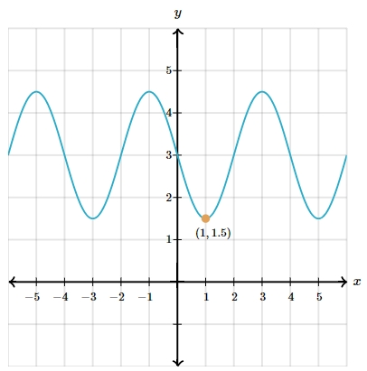
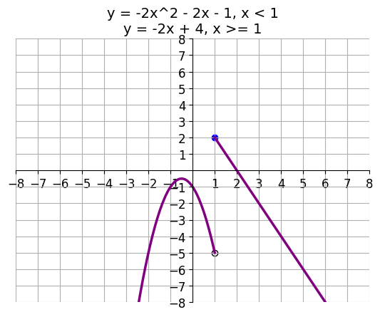

# AVP1604 — Single visual target

MathVerse:541 / DynaMath:87 · same type · Mathematical roles of graphical elements

## Shared or similar visual information

A filled circular point marker.

## Evidence locations

- Left image: The orange point labeled (1, 1.5) near the bottom of a wave.
- Right image: The filled purple point at (1, 2) starting the descending branch.

## Mathematical meanings

Left image: The dot highlights a particular local minimum on the continuing function curve. Right image: The dot includes the initial point of the linear branch defined for x ≥ 1.

## Same mathematical meanings

no

## Rationales

The feature identifies a specific point on the interior of the continuing graph in the left image and marks an endpoint included in the plotted branch in the right image. The orange point labeled (1, 1.5) near the bottom of a wave. The filled purple point at (1, 2) starting the descending branch.

Only the selected target is annotated. AI visual-review draft; not independently double-annotated by humans.
