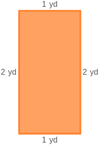

# AVP1607 — Single visual target

MathVista:56 / VisioMath:612_A · same type · Mathematical roles of graphical elements

[Right image in official archive](https://raw.githubusercontent.com/Nefefilibata/VisioMath/4a912153e110001da261917902e1d3cc163b7c6a/data/images.zip) · `images/612_A.jpg`

## Shared or similar visual information

A shaded region.

## Evidence locations

- Left image: The orange interior of the rectangle labeled 1 yd by 2 yd.
- Right image: The dark triangular patch crossing the lines of the square assembly.

## Mathematical meanings

Left image: The shading designates the entire planar rectangle whose area is specified by its side lengths. Right image: The shading selects the area of the triangle drawn across the assembly.

## Same mathematical meanings

yes

## Rationales

In both images the feature selects a geometric area. The orange interior of the rectangle labeled 1 yd by 2 yd. The dark triangular patch crossing the lines of the square assembly.

Only the selected target is annotated. AI visual-review draft; not independently double-annotated by humans.
