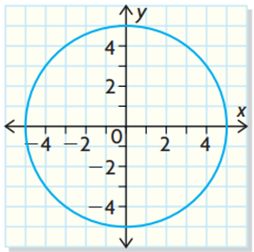

# AVP1611 — Single visual target

MathVista:409 / MathVerse:481 · different type · Mathematical roles of graphical elements

## Shared or similar visual information

An unfilled circular outline.

## Evidence locations

- Left image: The cyan circle centered where the two axes meet.
- Right image: The hollow circle at the left end of the curve at (−3, 0).

## Mathematical meanings

Left image: The outline is the circumference of the circle plotted around the origin. Right image: The open endpoint excludes (−3, 0) from the function graph.

## Same mathematical meanings

no

## Rationales

The feature traces the circumference of a geometric circle in the left image and marks an ordered pair excluded from the plotted trace in the right image. The cyan circle centered where the two axes meet. The hollow circle at the left end of the curve at (−3, 0).

Only the selected target is annotated. AI visual-review draft; not independently double-annotated by humans.
