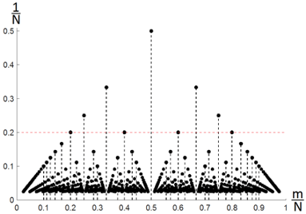
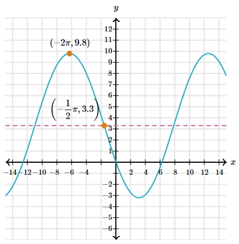

# AVP1612 — Single visual target

MathVista:738 / MathVerse:542 · same type · Mathematical roles of graphical elements

## Shared or similar visual information

A horizontal dashed line.

## Evidence locations

- Left image: The red dotted horizontal line through the 0.2 tick.
- Right image: The pink dashed horizontal line through the marked point of height 3.3.

## Mathematical meanings

Left image: The dotted line supplies a comparison level of 0.2 for the plotted points. Right image: The dashed line shows the fixed output level y = 3.3.

## Same mathematical meanings

yes

## Rationales

In both images the feature marks a fixed output level for comparison. The red dotted horizontal line through the 0.2 tick. The pink dashed horizontal line through the marked point of height 3.3.

Only the selected target is annotated. AI visual-review draft; not independently double-annotated by humans.
