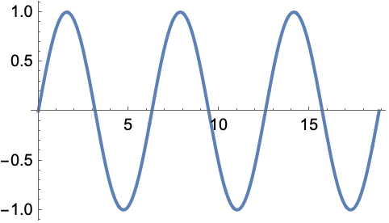
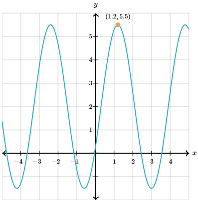

# AVP1615 — Single visual target

MathVista:308 / MathVerse:531 · same type · Mathematical roles of graphical elements

## Shared or similar visual information

A smooth oscillating curve.

## Evidence locations

- Left image: The blue wave with regularly spaced peaks of height 1.
- Right image: The cyan curve with repeating maxima including the labeled peak (1.2, 5.5).

## Mathematical meanings

Left image: The trace is a periodic graph repeating its output pattern at regularly spaced x values. Right image: The oscillating line is the graph of a periodic function with repeated peaks and valleys.

## Same mathematical meanings

yes

## Rationales

In both images the feature traces a repeating function graph. The blue wave with regularly spaced peaks of height 1. The cyan curve with repeating maxima including the labeled peak (1.2, 5.5).

Only the selected target is annotated. AI visual-review draft; not independently double-annotated by humans.
