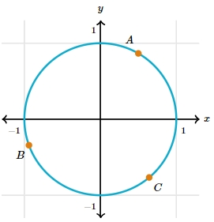

# AVP1616 — Single visual target

MathVista:37 / MathVerse:525 · different type · Mathematical roles of graphical elements

## Shared or similar visual information

An unfilled circular outline.

## Evidence locations

- Left image: The hollow point on g below the separate filled point.
- Right image: The cyan circle with A, B and C marked on it.

## Mathematical meanings

Left image: The hollow circle excludes that point on the otherwise continuous curve. Right image: The outline is the unit-circle circumference through the three marked points.

## Same mathematical meanings

no

## Rationales

The feature marks an ordered pair excluded from the plotted trace in the left image and traces the circumference of a geometric circle in the right image. The hollow point on g below the separate filled point. The cyan circle with A, B and C marked on it.

Only the selected target is annotated. AI visual-review draft; not independently double-annotated by humans.
