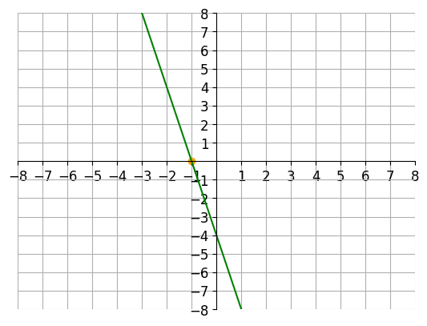
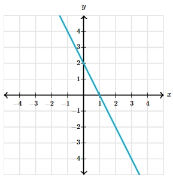

# AVP1620 — Single visual target

DynaMath:109 / MathVerse:591 · same type · Mathematical roles of graphical elements

## Shared or similar visual information

A solid straight line descending from left to right.

## Evidence locations

- Left image: The green line through the marked point near (−1, 0).
- Right image: The cyan falling line crossing the y-axis at 2 and x-axis at 1.

## Mathematical meanings

Left image: The straight trace plots a linear function decreasing at a constant rate. Right image: The straight trace plots a decreasing linear function.

## Same mathematical meanings

yes

## Rationales

In both images the feature plots a linear relationship between coordinates. The green line through the marked point near (−1, 0). The cyan falling line crossing the y-axis at 2 and x-axis at 1.

Only the selected target is annotated. AI visual-review draft; not independently double-annotated by humans.
