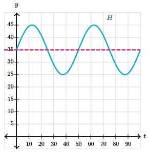

# AVP1621 — Single visual target

VisioMath:1338_A / MathVerse:548 · different type · Mathematical roles of graphical elements

[Left image in official archive](https://raw.githubusercontent.com/Nefefilibata/VisioMath/4a912153e110001da261917902e1d3cc163b7c6a/data/images.zip) · `images/1338_A.jpg`

## Shared or similar visual information

A horizontal dashed line.

## Evidence locations

- Left image: The long horizontal dashed line at the rear of the cube’s bottom face.
- Right image: The magenta dashed horizontal line at 35.

## Mathematical meanings

Left image: The dashed horizontal line represents the hidden rear edge of the cube base. Right image: The dashed line shows the central output level H = 35.

## Same mathematical meanings

no

## Rationales

The feature shows an occluded horizontal edge of a solid in the left image and marks a fixed output level for comparison in the right image. The long horizontal dashed line at the rear of the cube’s bottom face. The magenta dashed horizontal line at 35.

Only the selected target is annotated. AI visual-review draft; not independently double-annotated by humans.
