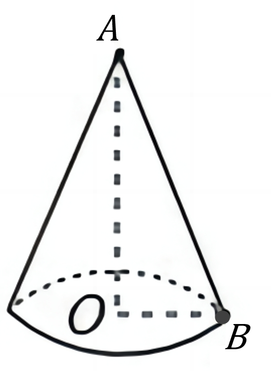

# AVP1625 — Single visual target

VisioMath:302_A / DynaMath:8 · same type · Mathematical roles of graphical elements

[Left image in official archive](https://raw.githubusercontent.com/Nefefilibata/VisioMath/4a912153e110001da261917902e1d3cc163b7c6a/data/images.zip) · `images/302_A.jpg`

## Shared or similar visual information

A dashed curve.

## Evidence locations

- Left image: The dashed arc spanning the rear portion of the cone base.
- Right image: The dashed arc along the rear half of the cone base near O.

## Mathematical meanings

Left image: The dashed arc represents the hidden half of the circular cone base. Right image: The dashed arc draws the occluded part of the cone’s circular base rim.

## Same mathematical meanings

yes

## Rationales

In both images the feature shows the occluded part of the circular rim of a solid. The dashed arc spanning the rear portion of the cone base. The dashed arc along the rear half of the cone base near O.

Only the selected target is annotated. AI visual-review draft; not independently double-annotated by humans.
