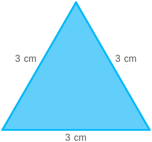

# AVP1628 — Single visual target

MathVista:441 / MathVerse:331 · same type · Mathematical roles of graphical elements

## Shared or similar visual information

A shaded region.

## Evidence locations

- Left image: The cyan triangle with three 3 cm side labels.
- Right image: The red wedge beside 45° at A.

## Mathematical meanings

Left image: The shading designates the entire area inside the equilateral triangle. Right image: The shading highlights the angle between the northward ray and ray AP.

## Same mathematical meanings

no

## Rationales

The feature selects a geometric area in the left image and highlights the angle between two rays in the right image. The cyan triangle with three 3 cm side labels. The red wedge beside 45° at A.

Only the selected target is annotated. AI visual-review draft; not independently double-annotated by humans.
