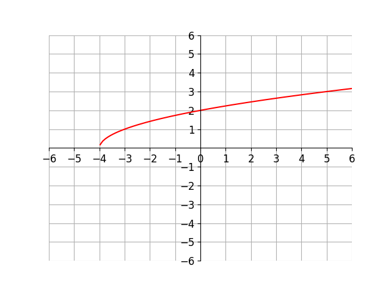

# AVP1629 — Single visual target

MathVista:767 / DynaMath:198 · different type · Mathematical roles of graphical elements

## Shared or similar visual information

The horizontal coordinate axis.

## Evidence locations

- Left image: The x-axis through the circle’s center and across the tangent drawing.
- Right image: The numbered line below the red increasing curve.

## Mathematical meanings

Left image: The axis gives the first Cartesian coordinate of points in the geometric construction. Right image: The horizontal axis gives the input coordinate for the function graph.

## Same mathematical meanings

yes

## Rationales

In both images the feature measures the horizontal Cartesian coordinate. The x-axis through the circle’s center and across the tangent drawing. The numbered line below the red increasing curve.

Only the selected target is annotated. AI visual-review draft; not independently double-annotated by humans.
