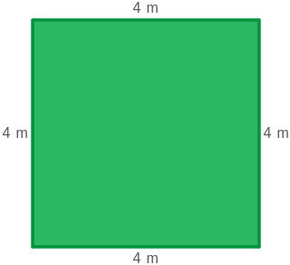

# AVP1634 — Single visual target

DynaMath:53 / MathVista:67 · same type · Mathematical roles of graphical elements

## Shared or similar visual information

A shaded region.

## Evidence locations

- Left image: The light-blue ring between the circles marked R = 7 and r = 5.
- Right image: The green square with 4 m on its sides.

## Mathematical meanings

Left image: The shading designates the annular area inside the outer circle and outside the inner circle. Right image: The shading designates the interior area of the square.

## Same mathematical meanings

yes

## Rationales

In both images the feature selects a geometric area. The light-blue ring between the circles marked R = 7 and r = 5. The green square with 4 m on its sides.

Only the selected target is annotated. AI visual-review draft; not independently double-annotated by humans.
