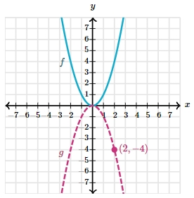

# AVP1635 — Single visual target

VisioMath:59_A / MathVerse:571 · different type · Mathematical roles of graphical elements

[Left image in official archive](https://raw.githubusercontent.com/Nefefilibata/VisioMath/4a912153e110001da261917902e1d3cc163b7c6a/data/images.zip) · `images/59_A.jpg`

## Shared or similar visual information

A dashed curve.

## Evidence locations

- Left image: The dashed arc on the back half of the right cylinder end.
- Right image: The dashed magenta downward-opening parabola labeled g.

## Mathematical meanings

Left image: The dashed arc represents the hidden portion of the rim of the cylinder’s right end. Right image: The dashed trace is the graph of g with a marked point at (2, −4).

## Same mathematical meanings

no

## Rationales

The feature shows the occluded part of the circular rim of a solid in the left image and plots the values of a function in the right image. The dashed arc on the back half of the right cylinder end. The dashed magenta downward-opening parabola labeled g.

Only the selected target is annotated. AI visual-review draft; not independently double-annotated by humans.
