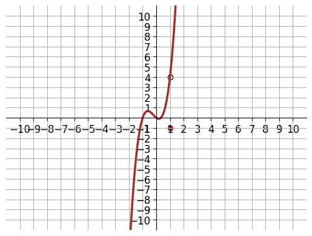
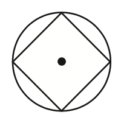

# AVP1637 — Single visual target

DynaMath:102 / MathVista:82 · different type · Mathematical roles of graphical elements

## Shared or similar visual information

An unfilled circular outline.

## Evidence locations

- Left image: The hollow circle on the red trace at x = 1, above the corresponding filled point.
- Right image: The single outer circle passing through all four corners of the tilted square.

## Mathematical meanings

Left image: The hollow circle marks a hole in the plotted curve. Right image: The outline is the circumcircle of the inscribed square.

## Same mathematical meanings

no

## Rationales

The feature marks an ordered pair excluded from the plotted trace in the left image and traces the circumference of a geometric circle in the right image. The hollow circle on the red trace at x = 1, above the corresponding filled point. The single outer circle passing through all four corners of the tilted square.

Only the selected target is annotated. AI visual-review draft; not independently double-annotated by humans.
