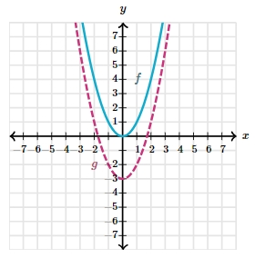
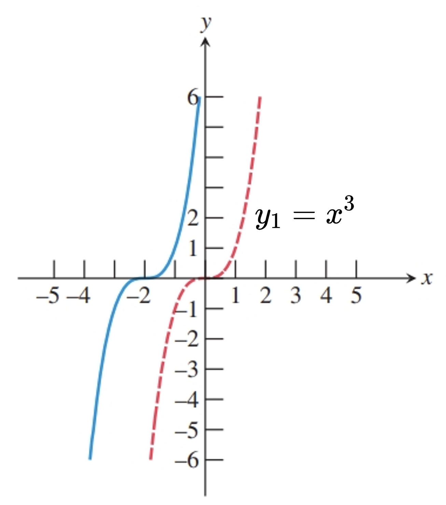

# AVP1638 — Single visual target

MathVerse:569 / MathVerse:599 · same type · Mathematical roles of graphical elements

## Shared or similar visual information

A dashed curve.

## Evidence locations

- Left image: The dashed magenta parabola labeled g, with its vertex below the origin.
- Right image: The red dashed increasing cubic-shaped curve to the right of the blue trace.

## Mathematical meanings

Left image: The dashed trace is the graph of g. Right image: The dashed trace is a cubic-shaped function graph used for comparison with the solid trace.

## Same mathematical meanings

yes

## Rationales

In both images the feature plots the values of a function. The dashed magenta parabola labeled g, with its vertex below the origin. The red dashed increasing cubic-shaped curve to the right of the blue trace.

Only the selected target is annotated. AI visual-review draft; not independently double-annotated by humans.
