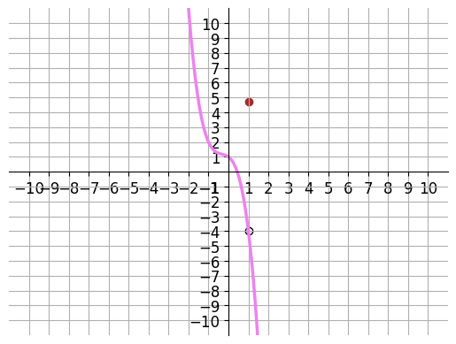

# AVP1640 — Single visual target

VisioMath:210_A / DynaMath:143 · same type · Mathematical roles of graphical elements

[Left image in official archive](https://raw.githubusercontent.com/Nefefilibata/VisioMath/4a912153e110001da261917902e1d3cc163b7c6a/data/images.zip) · `images/210_A.jpg`

## Shared or similar visual information

An unfilled circular outline.

## Evidence locations

- Left image: The hollow circle on the vertical axis between the two curved branches.
- Right image: The hollow circle on the purple curve at x = 1, below the filled point.

## Mathematical meanings

Left image: The hollow circle leaves the meeting point of the traces excluded. Right image: The hollow circle marks an omitted ordered pair on the purple curve.

## Same mathematical meanings

yes

## Rationales

In both images the feature marks an ordered pair excluded from the plotted trace. The hollow circle on the vertical axis between the two curved branches. The hollow circle on the purple curve at x = 1, below the filled point.

Only the selected target is annotated. AI visual-review draft; not independently double-annotated by humans.
