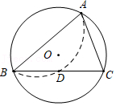

# AVP1641 — Single visual target

MathVista:700 / VisioMath:302_A · different type · Mathematical roles of graphical elements

[Right image in official archive](https://raw.githubusercontent.com/Nefefilibata/VisioMath/4a912153e110001da261917902e1d3cc163b7c6a/data/images.zip) · `images/302_A.jpg`

## Shared or similar visual information

A dashed curve.

## Evidence locations

- Left image: The dashed arc from B through D to A inside the circle.
- Right image: The dashed arc spanning the rear portion of the cone base.

## Mathematical meanings

Left image: The dashed trace is an auxiliary arc connecting points of the circle construction. Right image: The dashed arc represents the hidden half of the circular cone base.

## Same mathematical meanings

no

## Rationales

The feature represents an auxiliary arc in a plane construction in the left image and shows the occluded part of the circular rim of a solid in the right image. The dashed arc from B through D to A inside the circle. The dashed arc spanning the rear portion of the cone base.

Only the selected target is annotated. AI visual-review draft; not independently double-annotated by humans.
