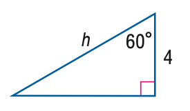

# AVP1642 — Single visual target

MathVista:665 / VisioMath:30_A · different type · Mathematical roles of graphical elements

[Right image in official archive](https://raw.githubusercontent.com/Nefefilibata/VisioMath/4a912153e110001da261917902e1d3cc163b7c6a/data/images.zip) · `images/30_A.jpg`

## Shared or similar visual information

A solid horizontal segment distinct from any axis or gridline.

## Evidence locations

- Left image: The horizontal blue edge meeting the leg labeled 4 at the square marker.
- Right image: The flat top of the plotted piecewise trace.

## Mathematical meanings

Left image: The horizontal edge is one leg and the base of the right triangle. Right image: The graph segment gives an interval of constant positive output.

## Same mathematical meanings

no

## Rationales

The feature forms a horizontal side of a polygon in the left image and plots a constant function output over an interval in the right image. The horizontal blue edge meeting the leg labeled 4 at the square marker. The flat top of the plotted piecewise trace.

Only the selected target is annotated. AI visual-review draft; not independently double-annotated by humans.
