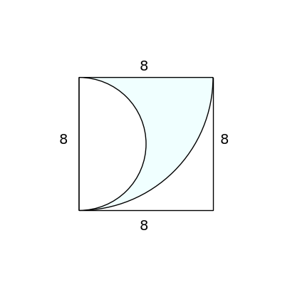

# AVP1643 — Single visual target

VisioMath:612_A / DynaMath:112 · same type · Mathematical roles of graphical elements

[Left image in official archive](https://raw.githubusercontent.com/Nefefilibata/VisioMath/4a912153e110001da261917902e1d3cc163b7c6a/data/images.zip) · `images/612_A.jpg`

## Shared or similar visual information

A shaded region.

## Evidence locations

- Left image: The dark triangular patch crossing the lines of the square assembly.
- Right image: The pale blue patch between the semicircle and the arc inside the square.

## Mathematical meanings

Left image: The shading selects the area of the triangle drawn across the assembly. Right image: The shading selects the area inside the arc and outside the semicircle within the square.

## Same mathematical meanings

yes

## Rationales

In both images the feature selects a geometric area. The dark triangular patch crossing the lines of the square assembly. The pale blue patch between the semicircle and the arc inside the square.

Only the selected target is annotated. AI visual-review draft; not independently double-annotated by humans.
