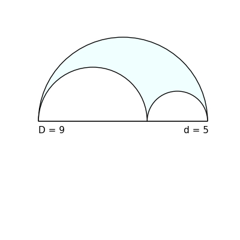
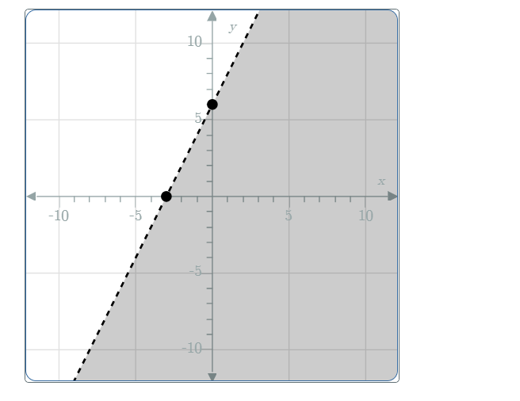

# AVP1648 — Single visual target

DynaMath:122 / MathVerse:511 · different type · Mathematical roles of graphical elements

## Shared or similar visual information

A shaded region.

## Evidence locations

- Left image: The pale blue patch inside the large semicircle and above the two smaller ones.
- Right image: The gray half-plane to the right of the rising dashed boundary.

## Mathematical meanings

Left image: The shading selects the area bounded by the three semicircular arcs. Right image: The shaded half-plane is the solution region of a strict linear inequality.

## Same mathematical meanings

no

## Rationales

The feature selects a geometric area in the left image and selects the solution half-plane of a linear inequality in the right image. The pale blue patch inside the large semicircle and above the two smaller ones. The gray half-plane to the right of the rising dashed boundary.

Only the selected target is annotated. AI visual-review draft; not independently double-annotated by humans.
