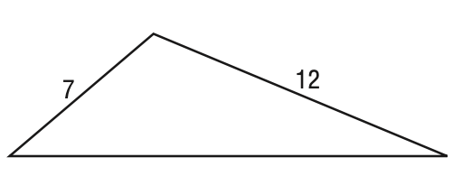

# AVP1652 — Single visual target

VisioMath:502_A / MathVista:615 · same type · Mathematical roles of graphical elements

[Left image in official archive](https://raw.githubusercontent.com/Nefefilibata/VisioMath/4a912153e110001da261917902e1d3cc163b7c6a/data/images.zip) · `images/502_A.jpg`

## Shared or similar visual information

A solid horizontal segment distinct from any axis or gridline.

## Evidence locations

- Left image: The long horizontal bottom edge of the outline.
- Right image: The unlabelled horizontal side of the triangular outline.

## Mathematical meanings

Left image: The horizontal segment is a triangle side used as its base. Right image: The horizontal segment is the base of a triangle.

## Same mathematical meanings

yes

## Rationales

In both images the feature forms a horizontal side of a polygon. The long horizontal bottom edge of the outline. The unlabelled horizontal side of the triangular outline.

Only the selected target is annotated. AI visual-review draft; not independently double-annotated by humans.
