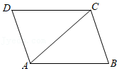

# AVP1656 — Single visual target

VisioMath:107_A / MathVista:32 · different type · Mathematical roles of graphical elements

[Left image in official archive](https://raw.githubusercontent.com/Nefefilibata/VisioMath/4a912153e110001da261917902e1d3cc163b7c6a/data/images.zip) · `images/107_A.jpg`

## Shared or similar visual information

A solid straight line rising from left to right.

## Evidence locations

- Left image: The oblique straight trace rising across both coordinate axes.
- Right image: The rising straight segment from A to C inside ABCD.

## Mathematical meanings

Left image: The straight trace gives a linear input-to-output relationship with positive slope. Right image: The segment is a diagonal connecting opposite vertices of the quadrilateral.

## Same mathematical meanings

no

## Rationales

The feature plots a linear relationship between coordinates in the left image and connects opposite vertices of a quadrilateral in the right image. The oblique straight trace rising across both coordinate axes. The rising straight segment from A to C inside ABCD.

Only the selected target is annotated. AI visual-review draft; not independently double-annotated by humans.
