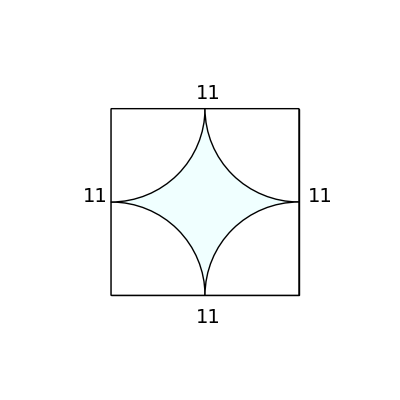

# AVP1657 — Single visual target

MathVerse:331 / DynaMath:154 · same type · Mathematical roles of graphical elements

## Shared or similar visual information

A shaded region.

## Evidence locations

- Left image: The red wedge beside 45° at A.
- Right image: The pale blue central patch between four quarter-circle arcs in the square.

## Mathematical meanings

Left image: The shading highlights the angle between the northward ray and ray AP. Right image: The shading selects the central area left outside the four corner sectors.

## Same mathematical meanings

no

## Rationales

The feature highlights the angle between two rays in the left image and selects a geometric area in the right image. The red wedge beside 45° at A. The pale blue central patch between four quarter-circle arcs in the square.

Only the selected target is annotated. AI visual-review draft; not independently double-annotated by humans.
