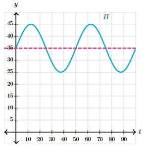

# AVP1659 — Single visual target

MathVerse:548 / VisioMath:505_A · different type · Mathematical roles of graphical elements

[Right image in official archive](https://raw.githubusercontent.com/Nefefilibata/VisioMath/4a912153e110001da261917902e1d3cc163b7c6a/data/images.zip) · `images/505_A.jpg`

## Shared or similar visual information

A horizontal dashed line.

## Evidence locations

- Left image: The magenta dashed horizontal line at 35.
- Right image: The horizontal dashed line at the bottom back of the rectangular box.

## Mathematical meanings

Left image: The dashed line shows the central output level H = 35. Right image: The dashed horizontal line depicts the hidden back edge of the box base.

## Same mathematical meanings

no

## Rationales

The feature marks a fixed output level for comparison in the left image and shows an occluded horizontal edge of a solid in the right image. The magenta dashed horizontal line at 35. The horizontal dashed line at the bottom back of the rectangular box.

Only the selected target is annotated. AI visual-review draft; not independently double-annotated by humans.
