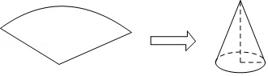

# AVP1661 — Single visual target

VisioMath:1226_A / MathVista:33 · same type · Mathematical roles of graphical elements

[Left image in official archive](https://raw.githubusercontent.com/Nefefilibata/VisioMath/4a912153e110001da261917902e1d3cc163b7c6a/data/images.zip) · `images/1226_A.jpg`

## Shared or similar visual information

A dashed curve.

## Evidence locations

- Left image: The elliptical rear arc of the hemisphere’s base drawn with dashes.
- Right image: The curved dashed arc at the rear of the cone base.

## Mathematical meanings

Left image: The dashed arc denotes the hidden part of the circular base rim of the hemisphere. Right image: The dashed arc draws the hidden part of the circular cone base.

## Same mathematical meanings

yes

## Rationales

In both images the feature shows the occluded part of the circular rim of a solid. The elliptical rear arc of the hemisphere’s base drawn with dashes. The curved dashed arc at the rear of the cone base.

Only the selected target is annotated. AI visual-review draft; not independently double-annotated by humans.
