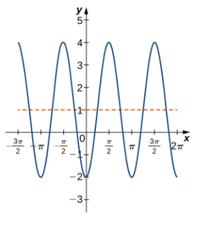
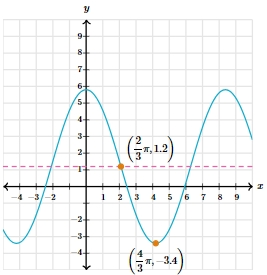

# AVP1662 — Single visual target

MathVista:592 / MathVerse:535 · same type · Mathematical roles of graphical elements

## Shared or similar visual information

A horizontal dashed line.

## Evidence locations

- Left image: The orange dashed horizontal line through the tick at 1.
- Right image: The magenta dashed horizontal line through the upper marked point.

## Mathematical meanings

Left image: The dashed line marks the fixed output level y = 1. Right image: The dashed line shows the fixed output level y = 1.2.

## Same mathematical meanings

yes

## Rationales

In both images the feature marks a fixed output level for comparison. The orange dashed horizontal line through the tick at 1. The magenta dashed horizontal line through the upper marked point.

Only the selected target is annotated. AI visual-review draft; not independently double-annotated by humans.
