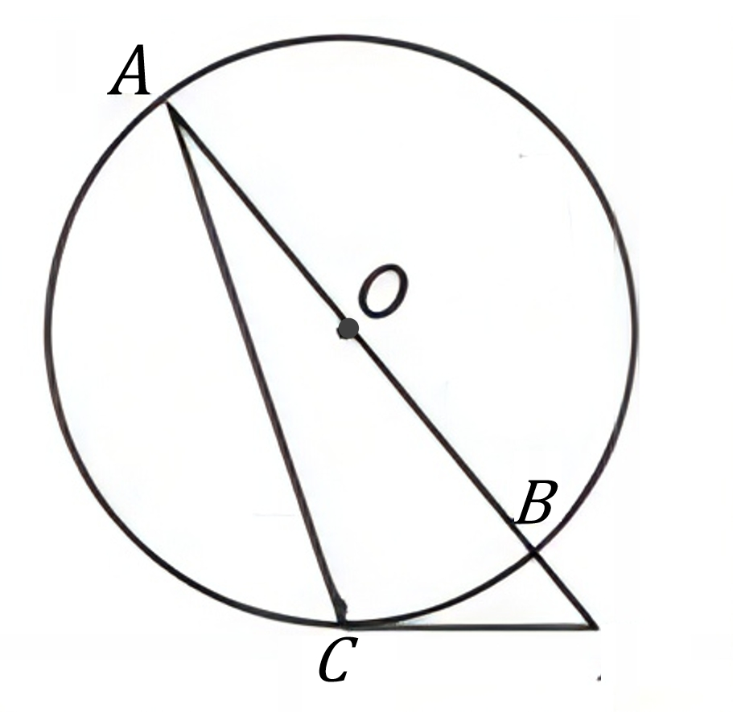
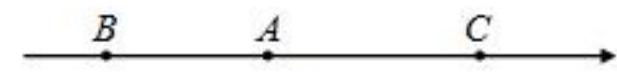

# AVP1665 — Single visual target

DynaMath:81 / MV-MATH:448_1 · same type · Mathematical roles of symbols

## Shared or similar visual information

The uppercase letter A.

## Evidence locations

- Left image: A at the upper endpoint of chord AC.
- Right image: A at the middle black point on the horizontal ray.

## Mathematical meanings

Left image: A names a specific point in the diagram (the upper endpoint of chord AC). Right image: A names a specific point in the diagram (the middle black point on the horizontal ray).

## Same mathematical meanings

yes

## Rationales

In both images, A names a specific point in the diagram. The relevant locations are the upper endpoint of chord AC on the left and the middle black point on the horizontal ray on the right.

Only the selected target is annotated. AI visual-review draft; not independently double-annotated by humans.
