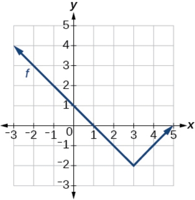
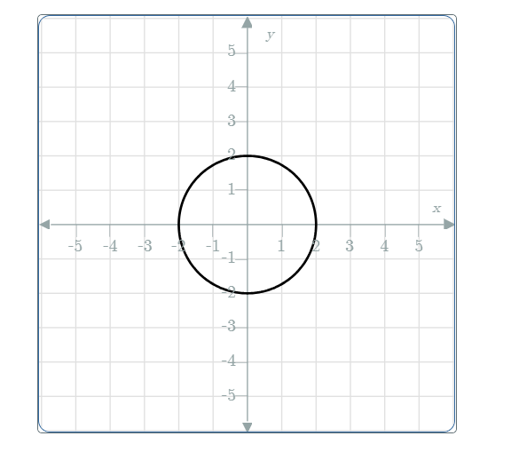

# AVP1667 — Single visual target

MathVerse:493 / MathVerse:453 · different type · Mathematical roles of symbols

## Shared or similar visual information

The lowercase letter x.

## Evidence locations

- Left image: x at the right tip of the horizontal axis beside the V-shaped graph.
- Right image: x at the right end of the horizontal axis passing through a circle.

## Mathematical meanings

Left image: x names the horizontal coordinate axis (the right tip of the horizontal axis beside the V-shaped graph). Right image: x names the horizontal coordinate axis (the right end of the horizontal axis passing through a circle).

## Same mathematical meanings

yes

## Rationales

In both images, x names the horizontal coordinate axis. The relevant locations are the right tip of the horizontal axis beside the V-shaped graph on the left and the right end of the horizontal axis passing through a circle on the right.

Only the selected target is annotated. AI visual-review draft; not independently double-annotated by humans.
