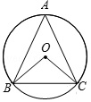
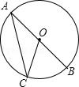

# AVP1669 — Single visual target

MathVista:270 / MathVista:285 · same type · Mathematical roles of symbols

## Shared or similar visual information

The uppercase letter O.

## Evidence locations

- Left image: O at the common endpoint of the radii to B and C.
- Right image: O at the center dot on the diameter AB.

## Mathematical meanings

Left image: O names the center of the circle (the common endpoint of the radii to B and C). Right image: O names the center of the circle (the center dot on the diameter AB).

## Same mathematical meanings

yes

## Rationales

In both images, O names the center of the circle. The relevant locations are the common endpoint of the radii to B and C on the left and the center dot on the diameter AB on the right.

Only the selected target is annotated. AI visual-review draft; not independently double-annotated by humans.
