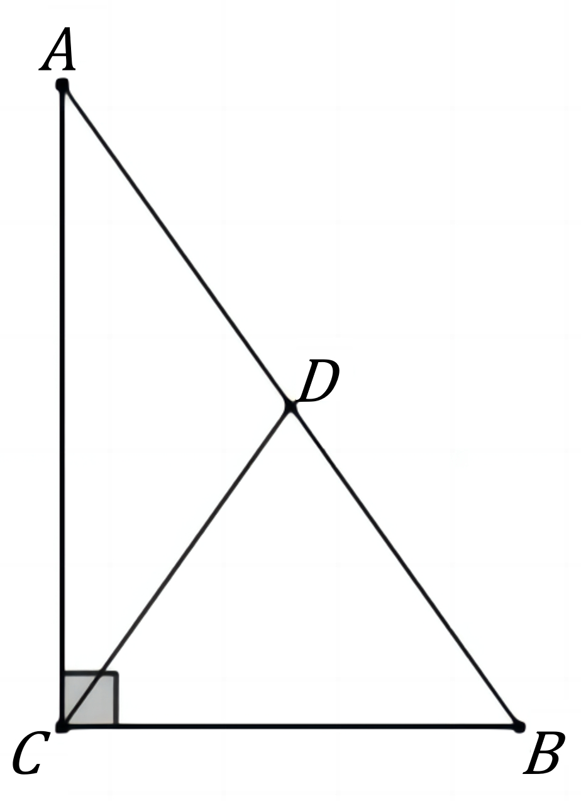
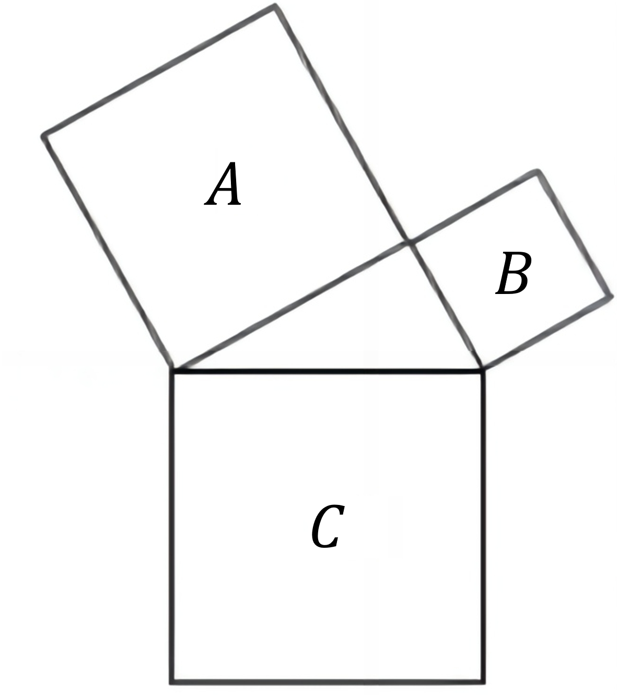

# AVP1670 — Single visual target

DynaMath:38 / DynaMath:85 · same type · Mathematical roles of symbols

## Shared or similar visual information

The uppercase letter B.

## Evidence locations

- Left image: B at the right endpoint of the horizontal leg.
- Right image: B at the label inside the smaller tilted square.

## Mathematical meanings

Left image: B names a specific point in the diagram (the right endpoint of the horizontal leg). Right image: B identifies a square region (the label inside the smaller tilted square).

## Same mathematical meanings

no

## Rationales

On the left, B names a specific point in the diagram (the right endpoint of the horizontal leg). On the right, B identifies a square region (the label inside the smaller tilted square).

Only the selected target is annotated. AI visual-review draft; not independently double-annotated by humans.
