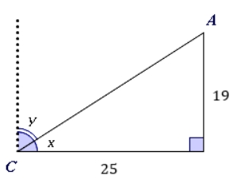
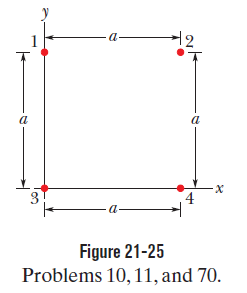

# AVP1674 — Single visual target

MathVerse:346 / MathVista:294 · same type · Mathematical roles of symbols

## Shared or similar visual information

The lowercase letter y.

## Evidence locations

- Left image: y at the wedge between the vertical dotted segment and the slanted side.
- Right image: y at the upper end of the vertical axis passing through points 1 and 3.

## Mathematical meanings

Left image: y gives an unknown angle measure (the wedge between the vertical dotted segment and the slanted side). Right image: y names the vertical coordinate axis (the upper end of the vertical axis passing through points 1 and 3).

## Same mathematical meanings

no

## Rationales

On the left, y represents an unknown angle measure (the wedge between the vertical dotted segment and the slanted side). On the right, y names the vertical coordinate axis (the upper end of the vertical axis passing through points 1 and 3).

Only the selected target is annotated. AI visual-review draft; not independently double-annotated by humans.
