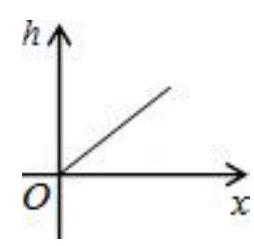
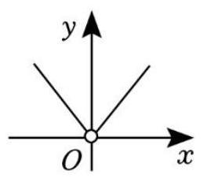

# AVP1675 — Single visual target

MV-MATH:1063_1 / MV-MATH:610_1 · same type · Mathematical roles of symbols

## Shared or similar visual information

The uppercase letter O.

## Evidence locations

- Left image: O at the label where the x and h axes meet.
- Right image: O at the label at the coordinate origin marked by an open circle.

## Mathematical meanings

Left image: O names the origin of the coordinate axes (the label where the x and h axes meet). Right image: O names the origin of the coordinate axes (the label at the coordinate origin marked by an open circle).

## Same mathematical meanings

yes

## Rationales

In both images, O names the origin of the coordinate axes. The relevant locations are the label where the x and h axes meet on the left and the label at the coordinate origin marked by an open circle on the right.

Only the selected target is annotated. AI visual-review draft; not independently double-annotated by humans.
