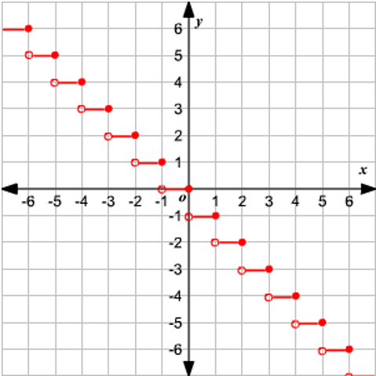
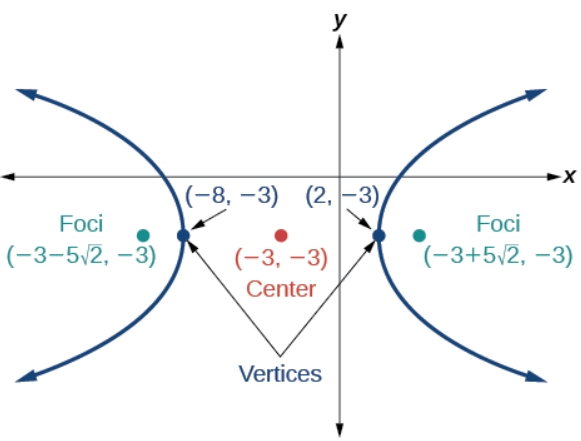

# AVP1677 — Single visual target

MathVista:34 / MathVerse:438 · different type · Mathematical roles of symbols

## Shared or similar visual information

The lowercase letter y.

## Evidence locations

- Left image: y at the top arrow above the red step graph.
- Right image: y at the top of the vertical axis on the hyperbola diagram.

## Mathematical meanings

Left image: y names the vertical coordinate axis (the top arrow above the red step graph). Right image: y names the vertical coordinate axis (the top of the vertical axis on the hyperbola diagram).

## Same mathematical meanings

yes

## Rationales

In both images, y names the vertical coordinate axis. The relevant locations are the top arrow above the red step graph on the left and the top of the vertical axis on the hyperbola diagram on the right.

Only the selected target is annotated. AI visual-review draft; not independently double-annotated by humans.
