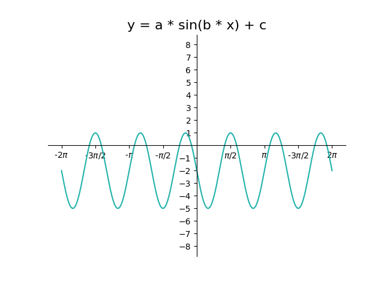

# AVP1681 — Single visual target

DynaMath:64 / DynaMath:345 · same type · Mathematical roles of symbols

## Shared or similar visual information

The lowercase letter y.

## Evidence locations

- Left image: y at the left-hand side of y = −(x + 5)(x − 5).
- Right image: y at the left-hand side of the sine expression above the plot.

## Mathematical meanings

Left image: y is the dependent output variable in the formula defining the graph (the left-hand side of y = −(x + 5)(x − 5)). Right image: y is the dependent output variable in the formula defining the graph (the left-hand side of the sine expression above the plot).

## Same mathematical meanings

yes

## Rationales

In both images, y is the dependent output variable in the formula defining the graph. The relevant locations are the left-hand side of y = −(x + 5)(x − 5) on the left and the left-hand side of the sine expression above the plot on the right.

Only the selected target is annotated. AI visual-review draft; not independently double-annotated by humans.
