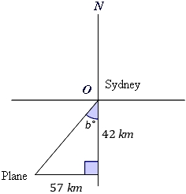
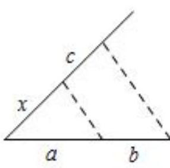

# AVP1682 — Single visual target

MathVerse:344 / MV-MATH:505_1 · same type · Mathematical roles of symbols

## Shared or similar visual information

The lowercase letter b.

## Evidence locations

- Left image: b at the b° label at O beside the dashed flight segment.
- Right image: b at the label beneath the right portion of the base.

## Mathematical meanings

Left image: b gives an unknown angle measure (the b° label at O beside the dashed flight segment). Right image: b gives an unknown length (the label beneath the right portion of the base).

## Same mathematical meanings

no

## Rationales

On the left, b represents an unknown angle measure (the b° label at O beside the dashed flight segment). On the right, b represents an unknown length (the label beneath the right portion of the base).

Only the selected target is annotated. AI visual-review draft; not independently double-annotated by humans.
